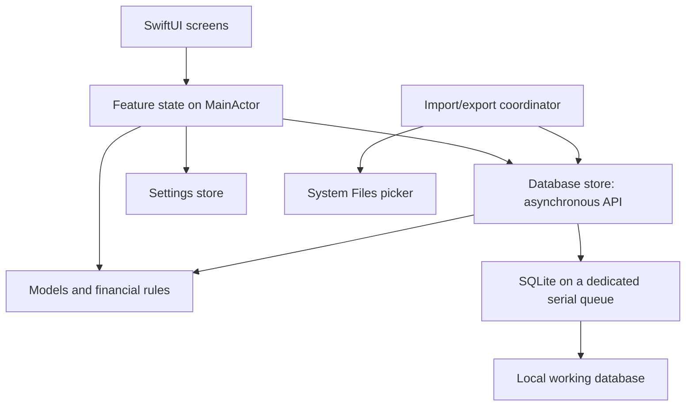

# Application Architecture

## Status and Decision Levels

This is the initial architecture proposal for discussion. It does not describe
implemented financial functionality or authorize application changes.

Confirmed constraints: iPhone/iOS 27, SwiftUI, system SQLite with a Trexpend-owned
schema, Trexpend-only replacement import, manual snapshot export, and the agreed
first-version screens. Initial MMEX conversion happens once on the computer.
This supersedes the earlier proposal to operate on a copy of the MMEX schema.
The component boundaries and names below are proposed implementation choices.
No new dependencies or separate Swift packages are required. The desktop
converter and v1 schema are now implemented and verified independently of the
application; see [development](development.md) and the completed converter plan.

## Main Components

| Component | Responsibility | Does not own |
| --- | --- | --- |
| SwiftUI views | Layout, navigation, controls, bindings, and presentation of loading/errors | SQL, persistence, or balance calculations |
| Feature state | Load a screen's data, own editor drafts, validate input, coordinate saves, and expose display state | SQLite handles or database column names |
| Models and finance rules | Typed accounts, currencies, transactions, summaries, exact arithmetic, and validation rules | SwiftUI or file access |
| Database store | Serialized SQLite access, record mapping, queries, related writes, and schema checks | Navigation or controls |
| Import/export coordinator | Stage files, validate replacements, switch datasets safely, and create snapshots through the store | Financial UI layout |
| Settings store | Typed dataset preferences through DatabaseStore/app_settings; device-only preferences through UserDefaults | Ledger calculations |

Feature state is similar to a small view model. Use it when a screen needs loading,
editing, or saving behavior; do not create a view model for every row or label.
Financial operations can be ordinary Swift functions and types. Avoid adding a
service/protocol/use-case hierarchy merely to forward calls between components.

## Data Flow



The arrows represent calls and ownership boundaries. Results return through the
same components; views render the resulting state.

### Reading

1. A screen requests data through its feature state.
2. The database store reads and maps the required records on its worker queue.
3. Financial rules calculate summaries from consistent input outside view rendering
   and off the main actor when processing a large dataset.
4. Feature state receives value results on the main actor and updates the UI.

Do not perform database queries or calculate totals inside a view's `body`.
Summary and list queries should read a consistent database snapshot. Avoid one
query per row and loading the entire history every time a row appears.

### Saving

1. The editor modifies a separate transaction draft, not the persisted record.
2. Feature state parses and validates date, amount, account, and transfer fields.
3. The store writes all related changes within one SQLite transaction.
4. Only a successful commit produces a successful save result.
5. Shared data revision changes; affected screens reload their lists and summaries.
6. The editor closes after success. On failure it retains the draft and shows an error.

Observation tracks Swift model properties, not arbitrary changes to a SQLite file.
A small explicit data revision is sufficient initially. Do not build a generic event
bus or keep every list in a single global observable object.

## Ownership and Execution

`TrexpendApp` creates the stores and shared session state once and injects them into
`RootView`. There are no global mutable singletons.

Proposed shared state: database availability, active dataset generation, committed
data revision, and settings. Feature state owns only its own results and drafts.
Views own transient presentation details such as a selected tab or an open sheet.

UI-facing observable objects use `@MainActor` and Observation (`@Observable`).
The owning view retains its state; child views receive only the values or bindings
they need. Read models passed from the database should be value types suitable for
crossing the concurrency boundary.

The database store exposes asynchronous operations but executes synchronous SQLite
and expensive file work on a dedicated serial DispatchQueue. The connection,
statements, transactions, import switch, and export snapshot creation are confined
to that queue. An `async` function alone does not move work off the main thread.
Exact Swift 6 isolation/Sendable declarations will be verified against the installed
SDK during implementation.

Each store write is one queue operation containing its complete transaction;
other operations cannot interleave inside it. A save request carries the dataset
generation it was created against. Reject a stale request after replacement import.
Discard late load results from an older dataset or superseded screen request.

Refresh visible screens after a committed write or settings change. Refresh
calendar-month summaries on foreground entry and month rollover; do not depend
solely on database writes for a new month's display.

## Account Balance Calculation

Calculate native-currency balances from initial_balance and complete eligible
history on demand. The nullable accounts.current_balance column is reserved and
left NULL; the initial application does not read or maintain it. DatabaseStore
reads the required accounting fields from a consistent snapshot, and finance
rules calculate Decimal results off the UI path. Batch account reads where useful;
do not load all transaction display fields just to calculate balances.

Reload affected balances and period summaries after successful commits. Financial
summaries must not depend on loaded history pages. Measure representative workloads
before proposing a persisted cache. Activating the reserved column later requires
an explicit maintenance and recovery design and an implementation plan.

## Persistence and Database Lifecycle

Proposed location: `Library/Application Support/Trexpend/` in the app container.
The original MMEX export remains untouched on the computer. An offline converter
will prepare a standalone database using the agreed Trexpend schema. The app
imports that file and operates on its own local copy; it does not keep a live
SQLite connection to a user-selected iCloud document. The converter is separate
from the application target and requires its own specification and plan.

On first launch without a database, show an import entry point rather than an
apparently empty but writable ledger. Creating a new ledger without import is
outside the currently agreed first-version scope.

SQLite is the source of truth for records and portable dataset settings in
app_settings. UI state is disposable. UserDefaults stores device-only preferences
that are excluded from SQLite snapshots. See [Settings](specs/user-settings.md).
Validate account/currency settings after database replacement.

Import/export follows [Database](database.md). During replacement, prevent new
writes, dismiss stale editors after a successful switch, reset navigation and
reload the new dataset. Failure leaves the current dataset and drafts available.
During export, finish in-flight writes before making the snapshot and temporarily
serialize subsequent writes behind snapshot creation.

Manual snapshots include app_settings and restore dataset preferences together
with the ledger. Reload SettingsStore after successful replacement. Device-only
UserDefaults values remain outside the snapshot; do not duplicate dataset settings
in both persistence mechanisms.

## Proposed Source Organization

Within `apps/ios/Trexpend/Trexpend/`, add folders as real files are implemented:

```text
TrexpendApp.swift
App/                  RootView, shared session state, dependency construction
Features/
  Home/               Dashboard view and its loading state
  Transactions/       Shared history list, account history, and editor
  Settings/           Settings view and its state
Models/               Account, Currency, Transaction, TransactionDraft, summaries
Finance/              Money parsing, conversion, balance and month rules
Data/                 DatabaseStore, SQLite helpers, Trexpend mapping, migrations
Files/                Import/export coordination
Resources/            Only if additional non-catalog resources are needed
Assets.xcassets/      Existing app icon, logo, and semantic colors
```

This is a proposed file map, not a scaffold to create now. Keep existing sources
in place until implementing their replacement. Introduce shared UI components
only when a real repeated pattern exists. The account and all-account lists can
share transaction rows and grouping while using different queries.

## Recommended Delivery Order

| Stage | Deliverable and reason | Required verification before moving on |
| --- | --- | --- |
| 1. Database design | Agree Trexpend tables, constraints, IDs, money/date/time representations, and selected source fields | Schema specification and conversion mapping; no unresolved balance semantics |
| 1a. Offline conversion | Create a Trexpend database on the computer from the original export | Source unchanged, valid constraints, complete selected history, verified balances and transfers |
| 2. Storage and replacement import | Open a local working copy and safely replace it from a supported Trexpend database | Failed-import preservation, restart persistence, original-file preservation |
| 3. Manual export and restore | Obtain a consistent independent snapshot before introducing transaction writes | Snapshot opens independently and restores through replacement import |
| 4. Navigation, settings, and history | Home/All/Settings shell; preferences; read-only account and all-account lists | Ordering, transfer identity, category/date mapping, empty/error states |
| 5. Financial summaries | Opening balances, account/month totals, display-currency conversion | Focused tests using synthetic fixtures; verify imported results privately |
| 6. Expense/income editor | Date, amount, account, category, notes; create and update | Validation, cancellation, commit failures, reload, preservation of hidden fields |
| 7. Transfers and deletion | Atomic transfers, cross-currency amounts, and swipe-revealed deletion | Both accounts update; no duplicated totals; failure leaves both sides unchanged |
| 8. Daily-use verification | Complete workflows on a physical iPhone | Relaunch, backgrounding, month rollover, backup/restore, and persisted edits |

Stages 1-3 establish the data safety foundation. Read-only UI then verifies our
understanding before writes are enabled. The first usable version is complete
only after transfers, deletion, and restoration work; intermediate stages are
not a finished daily-use application.

These are delivery milestones, not implementation plans. Write separate plans
in `docs/plans/` for the selected stage after its detailed specification is settled.

## Decisions Still Needed

- Trexpend schema, constraints, and the selected MMEX-to-Trexpend conversion mapping.
- Money range/codec constraints and source normalization/reconciliation rules.
  Monetary amounts use decimal TEXT at currencies.decimal_places precision.
- Final date/time encoding constraints and auxiliary offset derivation policies.
  Primary local transaction date/time drives the UI and summaries; a second
  offset-aware field is reserved for future use and updated only on creation or
  explicit occurrence-date/time edits. Midnight defaults are agreed.
- Supported amount range and final conversion queries; zero after rounding is allowed.
  Money uses its currency precision and nearest rounding with halfway cases away from zero;
  exchange-rate TEXT has no fixed fractional scale.
- Hidden-account behavior is deferred; do not add a hidden status in the first version.
  Closed accounts are excluded from Home rows and combined balance, preserved in
  history, and unavailable for ordinary new transactions. Existing records remain
  editable; a future account-management workflow will allow backdated corrections.
  Dashboard monthly totals include closed-account activity, as will future annual
  and custom-date-range summaries. Keep current-balance and period-summary filters
  separate.
- Finish final SQL and source mapping review; the audited source has no populated
  unsupported feature requiring an additional workflow beyond agreed omissions.
- Category defaults and type-change field rules; one category is required for all
  transaction types. Transfer principal excludes fee; fees count as expenses,
  with no separate fee category. Transfer-to-expense/income cleanup is confirmed; exact UI defaults remain open.
- SQLite journal mode and final Trexpend schema-version metadata.
- Imported created_at uses the confirmed updated_at proxy; retain remaining currency
  metadata and app_settings in SQLite. Complete final schema constraints and seeds
  using the conversion mapping and settings specification.

See [Database design](specs/database-design.md) for the schema discussion.
See [Financial behavior](specs/financial-behavior.md) for financial questions and
[Application screens](specs/application-screens.md) for proposed screen behavior.

## References

- [Apple: Managing model data](https://developer.apple.com/documentation/swiftui/managing-model-data-in-your-app/).
- [SQLite: Online Backup API](https://www.sqlite.org/backup.html).
