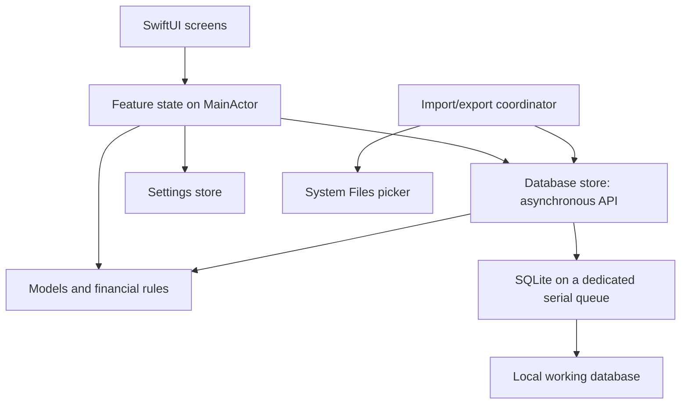

# Application Architecture

## Status and Decision Levels

The application shell and pure financial/date foundations are implemented and
verified. Serialized SQLite storage, automatic initialization, replacement import,
manual export, and confirmed reset are implemented. Read-only Home and display-
currency selection are implemented; read-only account and All histories are implemented; editing remains subsequent work.

Confirmed constraints: iPhone/iOS 27, SwiftUI, system SQLite with a Trexpend-owned
schema, Trexpend-only replacement import, manual snapshot export, and the agreed
first-version screens. MMEX conversion happens on the computer and can be repeated
to produce a new independent dataset, never to merge datasets.
This supersedes the earlier proposal to operate on a copy of the MMEX schema.
The overall source organization and storage location are accepted. Detailed
component APIs and names below remain proposed implementation choices.
No new dependencies or separate Swift packages are required. The desktop
converter and v1 schema are now implemented and verified independently of the
application; see [development](development.md) and the completed converter plan.

## Main Components

| Component | Responsibility | Does not own |
| --- | --- | --- |
| SwiftUI views | Layout, navigation, controls, bindings, and presentation of loading/errors | SQL, persistence, or balance calculations |
| Feature state | Load a screen's data, own editor drafts, validate input, coordinate saves, and expose display state | SQLite handles or database column names |
| Models and finance rules | Typed accounts, currencies, transactions, summaries, exact arithmetic, and validation rules | SwiftUI or file access |
| Database store | Serialized SQLite access, record mapping, queries, related writes, and schema checks | Navigation or controls |
| Import/export coordinator | Stage files, validate replacements, switch datasets safely, and create snapshots through the store | Financial UI layout |
| Settings store | Typed dataset preferences through DatabaseStore/app_settings; device-only preferences through UserDefaults | Ledger calculations |

Feature state is similar to a small view model. Use it when a screen needs loading,
editing, or saving behavior; do not create a view model for every row or label.
Financial operations can be ordinary Swift functions and types. Avoid adding a
service/protocol/use-case hierarchy merely to forward calls between components.

These are logical parts of one application target, organized into folders. They
are not separate applications, frameworks, or Swift packages. Keep the computer
converter outside the application. A future Mac or Android application does not
require extracting a cross-platform runtime now.

## Screen and State Ownership

| Screen or component | Owns | Requests from other components |
| --- | --- | --- |
| RootView | Startup/loading/error states, tabs, navigation, editor presentation | Database availability from AppSession |
| HomeView and HomeState | Dashboard loading, results, errors, selected account | A complete dashboard snapshot from DatabaseStore |
| AccountHistoryView and HistoryState | Account-scoped history, loading pages, summary, edit/delete actions | Account history and complete account totals |
| AllHistoryView and HistoryState | All-account history with account identity | Global history, with each transfer appearing once |
| TransactionEditorView and TransactionEditorState | An independent draft, input errors, pending save | Account/category choices, shared validation, atomic persistence |
| Account/category pickers | Search, expanded category branches, selection | Prepared choices from the owning feature state |
| SettingsView and SettingsState | Preference controls, import/export progress and errors | SettingsStore and file coordinator operations |

The history screens can use the same state type with an account or all-accounts
scope. Each screen owns a separate instance; they do not share a mutable loaded
list. Share transaction rows when their actual layouts justify it. Pickers do not
need independent database connections or a new service layer.

TransactionDraft is temporary input. Amount fields may contain strings while the
user types a decimal separator or an incomplete number. Shared rules turn valid
input into Decimal values before saving. Do not bind controls directly to a
persisted transaction or write on every keystroke.

Models represent records and results, such as Account, Currency, Transaction,
HomeSnapshot, and HistoryPage. Finance code defines money parsing and rounding,
balance calculations, conversion, and transaction validation. The same rules serve
Home, history, editor suggestions, and tests; screens must not reproduce formulas.

## Data Flow



The arrows represent calls and ownership boundaries. Results return through the
same components; views render the resulting state.

### Reading

1. A screen requests data through its feature state.
2. The database store reads and maps the required records on its worker queue.
3. Financial rules calculate summaries from consistent input outside view rendering
   and off the main actor when processing a large dataset.
4. Feature state receives value results on the main actor and updates the UI.

Do not perform database queries or calculate totals inside a view's `body`.
Summary and list queries should read a consistent database snapshot. Avoid one
query per row and loading the entire history every time a row appears.

For example, HomeState requests a dashboard using the selected display currency
and calendar month. DatabaseStore reads accounts, relevant accounting fields, and
rates in one consistent read operation, then applies the shared finance rules.
HomeState receives a HomeSnapshot containing ready-to-present results. HomeView
does not issue additional queries for each account. History loads can be paged,
while summaries still use the complete eligible history.

### Saving

1. The editor modifies a separate transaction draft, not the persisted record.
2. Feature state parses and validates date, amount, account, and transfer fields.
3. The store writes all related changes within one SQLite transaction.
4. Only a successful commit produces a successful save result.
5. Shared data revision changes; affected screens reload their lists and summaries.
6. The editor closes after success. On failure it retains the draft and shows an error.

Observation tracks Swift model properties, not arbitrary changes to a SQLite file.
A small explicit data revision is sufficient initially. Do not build a generic event
bus or keep every list in a single global observable object.

Saving a transfer includes both amounts, both account references, the selected
category, dates, notes, and fee fields in the same operation. There are no separate
source and destination saves. After commit, the shared revision invalidates visible
Home/history results. Those screens request fresh data; they do not adjust their
own copies of balances using separate arithmetic.

## Ownership and Execution

`TrexpendApp` creates the stores and shared session state once and injects them into
`RootView`. There are no global mutable singletons.

Proposed shared state: database availability, active dataset generation, committed
data revision, and access to typed settings through SettingsStore. Feature state
owns only its own results and drafts.
Views own transient presentation details such as a selected tab or an open sheet.

UI-facing observable objects use `@MainActor` and Observation (`@Observable`).
The owning view retains its state; child views receive only the values or bindings
they need. Read models passed from the database should be value types suitable for
crossing the concurrency boundary.

The database store exposes asynchronous operations but executes synchronous SQLite
and expensive file work on a dedicated serial DispatchQueue. The connection,
statements, transactions, import switch, and export snapshot creation are confined
to that queue. An `async` function alone does not move work off the main thread.
Exact Swift 6 isolation/Sendable declarations will be verified against the installed
SDK during implementation.

The existing target has MainActor default isolation and approachable concurrency
enabled. Worker-facing declarations and value models therefore need explicit
isolation review during implementation. Merely putting a call inside a queue or
marking a method async is not a complete isolation design. Keep SQLite handles
inside DatabaseStore; pass typed value results across the boundary.

AppDependencies can be a small construction container for the single store,
SettingsStore, file coordinator, and AppSession. It is not a dependency-injection
framework. AppSession contains dataset availability/generation/revision, not all
screen data. SettingsStore caches typed preferences and persists them through the
same DatabaseStore; it must not open another connection or become another source
of truth. These names remain proposals until the first implementation plan.

### Initial Shell and Later Service Construction

Start the shell with TrexpendApp retaining AppSession and injecting it into
RootView. RootView owns tab selection; each tab has its own navigation stack.
Without a loaded database, financial tabs show no-database content. During the
shell checkpoint there is no storage service or import workflow yet.

Add AppDependencies when storage introduces actual service instances, not as an
empty container. It constructs the one DatabaseStore and its settings/file
collaborators. Startup recovers interrupted replacements, then opens/validates the
working copy asynchronously. If no dataset exists, create a seeded initial ledger
automatically. AppSession reflects loading, readiness, or an error. Never silently
replace an unreadable existing file with a fresh ledger.

Generation/revision fields arrive with real replacement/write operations. Feature
state types arrive when a screen loads or edits data. This keeps the accepted
file map a guide to growth rather than a requirement to create unused types.

Each store write is one queue operation containing its complete transaction;
other operations cannot interleave inside it. A save request carries the dataset
generation it was created against. Reject a stale request after replacement import.
Discard late load results from an older dataset or superseded screen request.

Refresh visible screens after a committed write or settings change. Refresh
calendar-month summaries on foreground entry and month rollover; do not depend
solely on database writes for a new month's display.

## Account Balance Calculation

Calculate native-currency balances from initial_balance and complete eligible
history on demand. The nullable accounts.current_balance column is reserved and
left NULL; the initial application does not read or maintain it. DatabaseStore
reads the required accounting fields from a consistent snapshot, and finance
rules calculate Decimal results off the UI path. Batch account reads where useful;
do not load all transaction display fields just to calculate balances.

Reload affected balances and period summaries after successful commits. Financial
summaries must not depend on loaded history pages. Measure representative workloads
before proposing a persisted cache. Activating the reserved column later requires
an explicit maintenance and recovery design and an implementation plan.

## Persistence and Database Lifecycle

Proposed location: `Library/Application Support/Trexpend/` in the app container.
The original MMEX export remains untouched on the computer. The implemented offline converter
prepares a standalone database using the agreed Trexpend schema. The app
imports that file and operates on its own local copy; it does not keep a live
SQLite connection to a user-selected iCloud document. The converter is separate
from the application target and already has its own specification and completed plan.

On a clean first launch, automatically create a valid initial database; import is
optional. Reset Database in Settings recreates the same initial state after
explicit destructive confirmation. Schema/reference data and portable settings
still exist in an empty-history ledger. Preserve the full default category and
currency catalogs, but create no accounts or transactions. Initial display
currency is USD; default account and user name are NULL. Account creation remains
deferred, so current daily use requires an imported ledger. See
[Database lifecycle](specs/database-lifecycle.md). This supersedes
the earlier import-required first-launch proposal.

SQLite is the source of truth for records and portable dataset settings in
app_settings. UI state is disposable. UserDefaults stores device-only preferences
that are excluded from SQLite snapshots. See [Settings](specs/user-settings.md).
Validate account/currency settings after database replacement.

Import/export follows [Database](database.md). During replacement, prevent new
writes, dismiss stale editors after a successful switch, reset navigation and
reload the new dataset. Failure leaves the current dataset and drafts available.
During export, finish in-flight writes before making the snapshot and temporarily
serialize subsequent writes behind snapshot creation.

Manual snapshots include app_settings and restore dataset preferences together
with the ledger. Reload SettingsStore after successful replacement. Device-only
UserDefaults values remain outside the snapshot; do not duplicate dataset settings
in both persistence mechanisms.

The file coordinator handles the system picker, temporary access to selected
documents, staging, and progress. DatabaseStore owns validation of the staged
database, connection lifecycle, first-run initialization, replacement/reset, and
SQLite snapshot creation. Serialize these operations with ordinary reads and writes. A file
extension alone never establishes compatibility; check format identity, schema
version, integrity, foreign keys, and required application invariants.

## Proposed Source Organization

Within `apps/ios/Trexpend/Trexpend/`, add folders as real files are implemented:

```text
TrexpendApp.swift
App/
  AppDependencies.swift
  AppSession.swift
  RootView.swift
Features/
  Home/
    HomeView.swift
    HomeState.swift
  Transactions/
    History/
      AccountHistoryView.swift
      AllHistoryView.swift
      HistoryState.swift
      TransactionRow.swift
    Editor/
      TransactionEditorView.swift
      TransactionEditorState.swift
      TransactionDraft.swift
    Pickers/
      AccountPickerView.swift
      CategoryPickerView.swift
  Settings/
    SettingsView.swift
    SettingsState.swift
Models/                 Typed records and read results
Finance/
  MoneyCodec.swift
  BalanceCalculator.swift
  CurrencyConverter.swift
  TransactionValidator.swift
Data/
  DatabaseStore.swift
  SQLiteConnection.swift
  DatabaseValidator.swift
  SettingsStore.swift
Files/
  DatabaseFileCoordinator.swift
Assets.xcassets/        Existing icon/logo/colors; account images when implemented
```

This is a proposed file map, not a scaffold to create now. Keep existing sources
in place until implementing their replacement. Introduce shared UI components
only when a real repeated pattern exists. The account and all-account lists can
share transaction rows and grouping while using different queries.

Split model files by meaningful type as needed. Split DatabaseStore queries into
focused files, such as DatabaseStore+Transactions.swift, when it becomes large;
all such files still use the same serialized access and connection. Do not create
a connection per feature or a repository class for every table by default.

The canonical SQL remains in database/migrations/. When the app needs migration
resources, explicitly include the required SQL in the application bundle through
the Xcode project; avoid maintaining an independently edited duplicate schema.
Tests get a test target and synthetic fixtures when the first tested components
are implemented. Personal databases are never bundled, used in committed previews,
or copied into test fixtures.

## Recommended Delivery Order

| Stage | Deliverable and reason | Required verification before moving on |
| --- | --- | --- |
| Completed foundation | Owned v1 schema, offline converter, converted private dataset | Converter tests, reconciliation, integrity/FK checks, independent reopen; not yet iOS integration |
| 1. Application shell (complete) | RootView and Home/All/Settings navigation with explicit no-database state | Build and launch; tabs work; no fake balances or writable empty ledger |
| 2. Shared financial and date rules (complete) | Decimal parsing/rounding, currency precision, local date handling, balances and conversion | Focused synthetic tests; shell still builds and launches |
| 3. Storage, initialization, and replacement import (complete) | Automatically create/reopen a working database; read records/settings; import supported Trexpend databases | Invalid imports preserve existing data; restart reopens the same working copy; source is unchanged |
| 4. Manual export, restore, and reset (complete) | Consistent independent snapshot before financial edits are introduced | Export opens independently; replacement restore recovers ledger and dataset settings |
| 5. Read-only Home and display currency (complete) | Account rows, computed balances, monthly summaries, display-currency picker; default-account picker deferred to editing | Synthetic financial tests, currency persistence, missing rates, closed-account filters, Simulator layout |
| 6. Read-only history (implemented) | Account and All histories, shared rows, date grouping, paging, complete summaries, transfer identity | Both transfer directions, transfers once in All, totals independent of pages; see history plans for runtime verification |
| 7. Expense/income editor | Create and update using dates, account/category choices, amounts and notes | Cancellation, duplicate Save protection, commit failures, relaunch persistence, visible-screen reload |
| 8. Transfers and deletion | Two amounts, cross-currency suggestions, fee, editing and swipe-revealed deletion | Atomic changes; fee counts as expense; unrelated edits preserve amounts; both account summaries refresh |
| 9. Daily-use verification | Complete workflows on a physical iPhone | Relaunch, backgrounding, month rollover, export/restore, replacement and persisted edits |

Keep the app buildable and runnable after each stage. For stage 2, the meaningful
new evidence is unit tests; its screen can remain unchanged. Stages 3-4 provide
file workflows that can be tried before transaction editing. Stages 5-6 expose
real read-only results before financial writes. Stage 7 alone is not a finished
daily-use application: transfers, deletion, and restoration must also work.

Each application-code or project-configuration stage requires an appropriate
build. Use Simulator checks for navigation, files, and editor interactions, and
focused tests for finance, persistence, migration, and replacement failure paths.
Use synthetic fixtures for committed tests and previews. Import personal data
only for private local verification. Avoid rebuilding the dataset for each stage;
the app must reopen its own working copy across launches.

These are delivery milestones, not implementation plans. Write separate plans
in `docs/plans/` for the selected stage after its detailed specification is settled.

Completed initial plans, including implementation and verification results:

- [Application shell](plans/completed/application-shell.md).
- [Financial and date foundations](plans/completed/financial-foundations.md).

Completed storage plans, including verification and platform limitations:

- [Database storage and import](plans/completed/database-storage-and-import.md).
- [Database export and reset](plans/completed/database-export-and-reset.md).

## Settled Foundations and Remaining Design Work

The schema, conversion mapping, format/version metadata, money storage, date
encoding, and initial conversion are documented and implemented. They are not
open architecture questions. See [Database schema](specs/database-schema.md) and
[MMEX conversion](specs/mmex-conversion.md). Deliberate source omissions and
historical timestamp approximations remain part of the agreed migration contract.

Before the relevant stage, settle only its remaining details:

- Storage foundations are implemented; future schema upgrades require separate
  migration plans. Physical-device/iCloud verification remains a documented gap.
- Navigation and layout: account grouping, create-button placement, transfer row
  arrangement, and final confirmation presentation.
- Editor: exact category defaults and interaction details for rate suggestions,
  account changes, and dirty-draft dismissal. Financial field rules already agreed
  in the specifications must not be reopened as unspecified requirements.
- Performance: measure complete-history summary reads and page sizes with actual
  local workloads before introducing caches or additional indexing.

Account/category management, custom images, hidden accounts, attachments,
automatic exchange-rate updates, external/cloud backup destinations, and other platforms remain
separate future features. Their absence does not block the current architecture.

See [Database design](specs/database-design.md) for the schema discussion.
See [Financial behavior](specs/financial-behavior.md) for financial questions and
[Application screens](specs/application-screens.md) for proposed screen behavior.

## References

- [Apple: Managing model data](https://developer.apple.com/documentation/swiftui/managing-model-data-in-your-app/).
- [SQLite: Online Backup API](https://www.sqlite.org/backup.html).

## Reliability Follow-up (2026-10-18)

The database lifecycle distinguishes fast working-file opening from full file
validation. The shell and Settings remain independent of database readiness;
recovery import/reset can replace an unreadable ledger without opening it.
Daily launch-triggered snapshots are exposed through Documents/Backups, while
working files and recovery archives stay private. Canonical v1 SQL comparison is
unchanged; additional cross-platform schema compatibility work is deferred.

See [Database reliability fixes](plans/completed/database-reliability-fixes.md).

## Home Dashboard Implementation

HomeState loads a generation-guarded HomeSnapshot through DatabaseStore. HomeRead
maps accounts/currencies and scans transactions once inside a deferred SQLite read
transaction on the existing serial worker. BalanceCalculator supplies native
balances; exact monthly accumulation excludes transfer principal and includes
fees. CurrencyConverter values each complete aggregate, rounding only its final
result. Missing-rate errors affect dependent converted figures independently.

HomeSummaryView and HomeAccountView handle presentation only. MoneyPresentation
formats Decimal through NSDecimalNumber without converting money to Double.
HomeState rejects cancelled/superseded results and results for an obsolete dataset
or display currency. Refresh follows foreground activation, local month rollover,
preference changes, retry, and pull-to-refresh. Current balance remains computed.

SettingsState loads the currency catalog and saves display_currency_id through a
bound, generation-checked transaction. AppSession publishes refreshed settings
after commit, triggering a new Home request. No amounts or rates are rewritten.
Default-account selection is deferred to the editor stage; it is not needed for
read-only Home. See the [Home plan](plans/completed/home-dashboard.md).

## Account History Implementation

Home account links push AccountHistoryView. HistoryState owns the initial snapshot,
rows/cursor, initial/page errors, and request identity. Initial summary and first
page share a coherent SQLite transaction on DatabaseStore. HistoryRead maps only
account-relevant financial history for the complete summary; later pages use
bounded source/destination indexed queries with a date/ID cursor. A page error
retains loaded rows; retry and refresh have separate behavior. Generation and
currency guards reject superseded results. All has equivalent global-page state.

AccountSummaryView and TransactionRowView present ready financial values.
CategoryIconView resolves database SF Symbol names with a general fallback.
Category icon selection belongs to categories, never individual transactions.
Transfer rows always use neutral arrows, both stored amounts, and explicit fees.
No editor/creation/deletion controls are exposed yet.

DatabaseMigrator updates staged v1 candidates to v2 using bundled canonical SQL
and a shared public default-path JSON mapping. DatabaseValidator retains strict
version-specific schema checks. V1 backup/import recovery uses the same safe
replacement workflow, while ordinary v2 opens keep fast validation. The offline
converter uses the same migration/mapping resources. See the
[Account history plan](plans/account-history.md).

## All History Read Ownership

AllHistoryRead queries the global descending transaction index with a bound
date/ID cursor and 50 visible rows plus look-ahead. Bounded joins provide account,
currency, category, icon, and fee ownership; transfers are queried once. The first
page and the Home-compatible summary share one SQLite read transaction. Later
pages do not recompute financial totals. AllHistoryState rejects obsolete requests
and preserves rows on a page failure. No schema or original source data changes
are needed. Ordinary rows share TransactionRowView with optional account context;
AllTransferRowView owns the two-section global transfer presentation.
See the [All history plan](plans/completed/all-history.md) for verification status.
